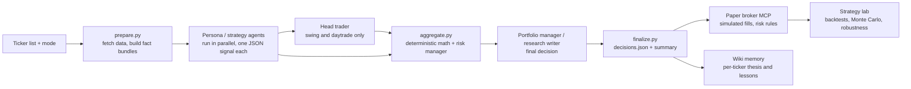

# AI Hedge Fund: multi-agent stock analysis, paper broker and strategy lab

A research system that runs about 28 AI analyst agents inside **Claude Code** to analyse a stock from several independent viewpoints, combines their views through deterministic math and risk checks, and records the decision. It has a simulated (paper) broker with prop-firm risk rules, a strategy lab with backtests and Monte Carlo simulation, and an automated test suite.

> **Paper trading only.** No real money is traded and this README makes no claim of profit. See [Results](#results-and-honesty).

---

## At a glance

| | |
|---|---|
| **Agents** | 14 investor personas (Buffett, Munger, Graham, Burry and others), 5 swing strategies, 9 intraday strategies, plus head-trader, portfolio-manager, research-writer, explainer and wiki-curator agents (42 prompt files) |
| **Modes** | `/invest`, `/swing`, `/daytrade`, `/research` (Claude Code slash commands) |
| **Data** | Free sources only: yfinance, SEC EDGAR company facts, Finnhub free tier |
| **Deterministic layer** | Fundamentals, valuation, technicals, sentiment and a risk manager in plain Python, with no LLM involved |
| **Paper broker** | SQLite-backed simulated broker, exposed to Claude as an MCP server (quotes, orders, brackets, positions, history) |
| **Strategy lab** | Intraday strategy simulator, prop-firm evaluation simulator, Monte Carlo (5,000 paths), robustness checks |
| **Tests** | 61 pytest tests (58 run offline; 3 need a Turso database URL) |

## Architecture



The pattern is the same in every mode: **several independent opinions, then synthesis, then one decision.** The LLM agents give judgement; anything that is arithmetic (valuation, indicators, position limits, correlation caps, earnings blackout) is done in deterministic Python, so the numbers can be reproduced and tested.

## The design work

This project is a good example of the work a business analyst does on a technical product: turning a vague goal into requirements, a process design, controls and measurable checks.

1. **Requirements.** Define what a usable decision needs (entry, target, stop, risk/reward, holding period, confidence) and which inputs are allowed (free data only, no paid LLM API). These became Pydantic schemas that every agent output must pass.
2. **Agent orchestration.** One process for every mode: independent analysts in parallel, a head trader who must resolve real disagreements, a portfolio manager who decides. Nine overlapping swing strategies were cut to five distinct viewpoints so the synthesis step weighs real disagreement, not echoes. Missing agent outputs are flagged as `degraded_inputs`, not ignored.
3. **Deterministic math and controls.** Valuation, technicals and risk rules sit outside the LLM: earnings blackout within 3 days, correlation cap of 0.7, cluster exposure cap of 30%, no stacking of same-direction positions.
4. **Validation.** A paper broker that enforces prop-firm rules (trailing max loss, end-of-day flat, contract caps, consistency rule), and a strategy lab that tests rules over many days, rolls evaluations forward and runs Monte Carlo simulations of pass/fail odds before anything goes near a live account.

### Credits and what I built

This repository started from [NamanVinayak/claude-code-hedge-fund](https://github.com/NamanVinayak/claude-code-hedge-fund) (MIT licence, see `LICENSE`), itself a zero-cost re-implementation of [virattt/ai-hedge-fund](https://github.com/virattt/ai-hedge-fund). The persona agents, the base orchestration pipeline and the wiki layer come from that project.

My own work on top of it:

- **Paper broker** (`paper_broker/`): live-price simulated broker with futures, bracket orders and a correct fill order (earliest trigger first, stop wins ties, no look-ahead), the MyFundedFutures Rapid 50K rule set, and an MCP server so Claude can trade the paper account through tools.
- **Strategy lab** (`strategy_lab/`): indicators, three intraday strategies, an evaluation simulator, rolling evaluations, Monte Carlo and robustness tests, and an execution desk for an MNQ VWAP-reversion strategy.
- **Data fixes** (`ai_hedge/data/`): correct trailing-twelve-month figures from SEC filings (fiscal Q4, year-to-date cash flow, TTM EPS, alternative XBRL tags), a yfinance fallback for statements, and near-live futures estimates from real-time ETFs (about 1 point of MNQ error compared with 21 points on delayed data).
- **Day-trade facts for index futures**: New York cash-session handling, overnight range and gap, and a fix for the head trader's output failing schema validation.
- **Tooling**: TradingView Pine export of the paper account, an `/autotrade` skill with scheduled Windows launchers, a YouTube transcript MCP server for research, and tests for all of the above (`tests/test_paper_broker*.py`, `test_sec_edgar_ttm.py`, `test_live_estimate.py`).

## How to run

Requirements: Python 3.10+ and [Claude Code](https://claude.com/claude-code).

```bash
git clone https://github.com/elkhazzananass2004-cpu/ai-hedge-fund.git
cd ai-hedge-fund
python -m venv .venv && source .venv/bin/activate   # Windows: .venv\Scripts\activate
pip install -e .
cp .env.example .env        # optional: add a free Finnhub key
```

Inside Claude Code, from the repo root:

```text
/swing TSLA
/invest AAPL,MSFT
/daytrade SPY
/research NVDA
```

Pipeline steps by hand (see `RUN_PLAYBOOK.md` for the full playbook):

```bash
python -m ai_hedge.runner.prepare --tickers AAPL --run-id test --mode swing
# dispatch the agents in Claude Code, then:
python -m ai_hedge.runner.aggregate --run-id test --tickers AAPL
python -m ai_hedge.runner.finalize --run-id test
```

Tests and strategy lab:

```bash
python -m pytest tests
python -m strategy_lab.run_lab        # needs minute data; see strategy_lab/data.py
```

## Tech stack

Python (pandas, NumPy, Pydantic, SQLite, Jinja2), Claude Code subagents and skills, Model Context Protocol (MCP) servers, yfinance, SEC EDGAR, Finnhub, pytest, GitHub Actions, TradingView Pine Script, PowerShell.

## Repository map

| Path | What it holds |
|---|---|
| `ai_hedge/` | Data providers, deterministic agents, persona prompts, runner (prepare, aggregate, finalize), grading, wiki |
| `paper_broker/` | Simulated broker, market data, MCP server, TradingView export |
| `strategy_lab/` | Strategies, simulator, Monte Carlo, robustness, sample results |
| `tracker/` | Trade tracker, simulator, ingester, backtest |
| `dashboard/` | Static dashboard builder (Jinja2) |
| `.claude/skills/` | Claude Code slash commands |
| `tests/` | pytest suite |
| `CLAUDE.md`, `ARCHITECTURE.md`, `AGENTS.md` | Design notes, architecture audit and roadmap |

## Results and honesty

- Everything here is **paper trading or backtesting**. No live capital.
- Performance numbers in this repository are labelled as backtest or paper. Detailed results are kept in a separate private log, not here.
- One finding is worth stating plainly: across 10 years of tests, none of the intraday rules tried (VWAP reversion, opening-range breakout, trend pullback, EMA 9/21, a dozen intraday effects) showed a lasting edge. Recording a negative result like this is part of the method.

## Disclaimer

Educational project. **Not financial advice.** Nothing in this repository is a recommendation to buy or sell any security. Use at your own risk.

## Licence

MIT. See `LICENSE` (original copyright Naman Vinayak; modifications by the repository owner).
